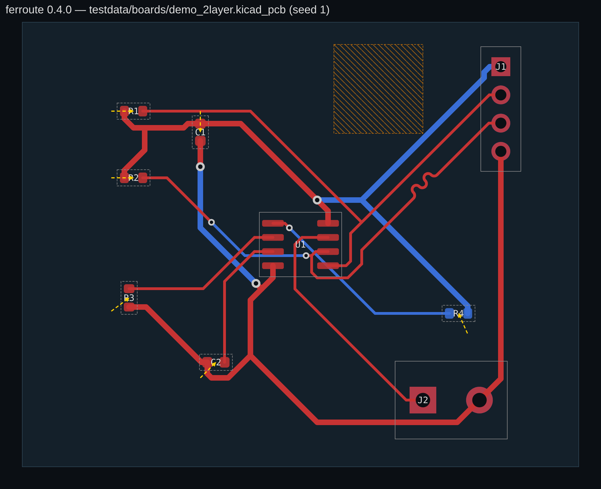
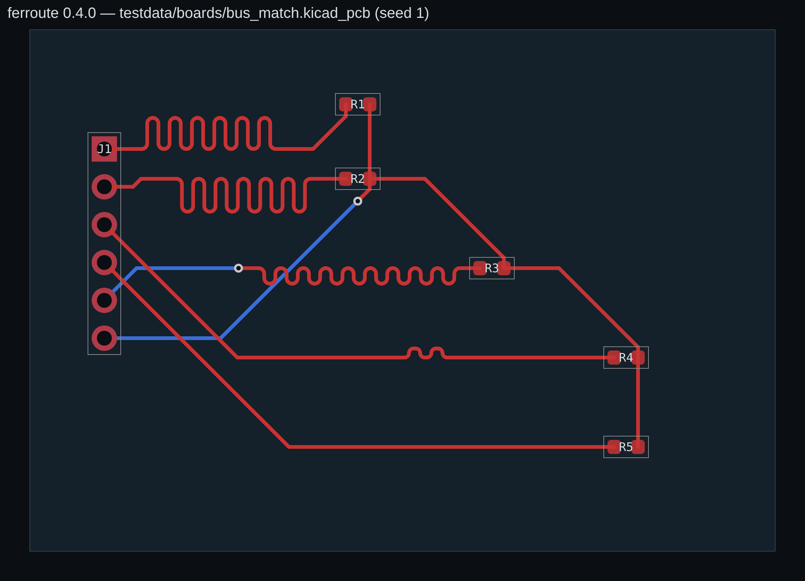
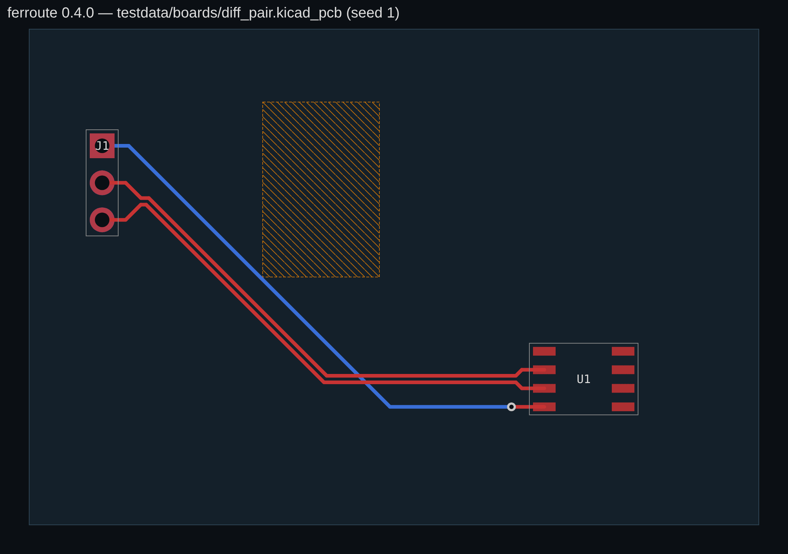
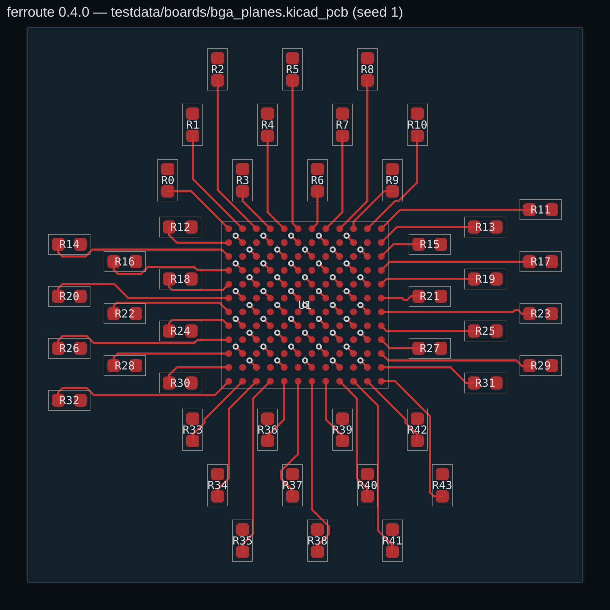
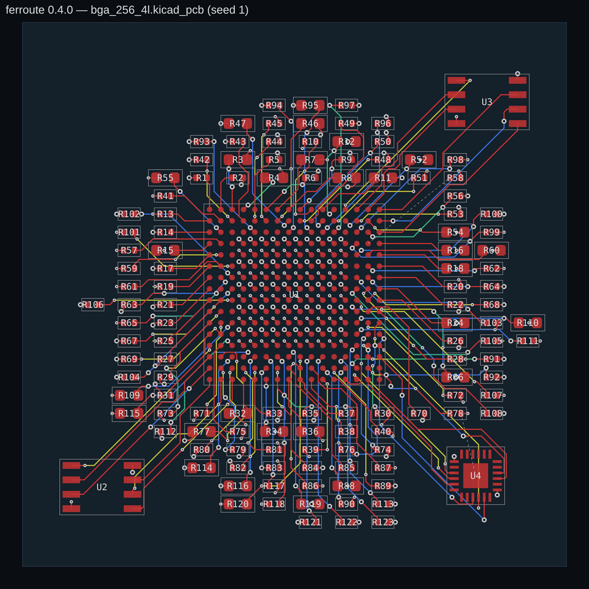

# ferroute

**Placement-aware, GPU/multi-core accelerated PCB autorouter for KiCad 10 & 11 — written in Rust, with an exact DRC oracle that gates every result.**

[](https://github.com/vanhanit/ferroute/actions/workflows/ci-release.yml)
[](LICENSE)
[](COMMERCIAL.md)



*`testdata/boards/demo_2layer.kicad_pcb` (KiCad 10) routed by `ferroute route --allow-move`
with a length rule on `SCL` (rounded meander): 100 % completion, 6 vias, 0 DRC errors in
ferroute's oracle and in KiCad 10.0.8 `kicad-cli pcb drc`. Yellow arrows show unlocked passives
that were nudged; the hatched area is a keep-out.*

## Why another autorouter?

Existing KiCad autorouting stalls on dense boards: nets are committed greedily one at a
time, rip-up passes cycle without memory, and placement is treated as immutable even
when moving one resistor half a millimetre would open a channel. ferroute combines:

* **Negotiated congestion (PathFinder)** on a multi-layer octilinear lattice: all nets
  compete for resources with present + history costs, followed by LNS rip-up rounds.
* **Placement co-optimisation:** explicitly *unlocked* parts (default `R*`, `C*`, `L*`,
  `FB*`; your globs) are nudged within a bound, onto an absolute placement grid
  (`--move-grid`), with 90 deg / 180 deg rotations when that helps routing.
  **Locked footprints never move.**
* **Clean geometry:** 0/45/90 deg tracks, straightened and de-kinked; every connection
  enters its pad along an axis through the centre and ends exactly at the centre; no acid
  traps.
* **Correct by construction, verified anyway:** a *lattice separation theorem* plus exact
  integer predicates; the independent DRC oracle refuses to emit anything it flags.
* **Differential pairs:** coupled routing with constant gap and symmetric fans.
* **Length and delay matching** (`[[match]]`, nested groups, `skew_mm` / `skew_ps`) with
  uniform accordion meanders whose corners are true KiCad arcs.
* **Per-net electrical rules:** current (IPC-2221), impedance, frequency, via limits,
  length; unmet rules are reported, `--strict-rules` fails the run.
* **KiCad custom rules (`.kicad_dru`):** clearance, track width, via, hole, edge, annular
  and diff-pair gap rules, `max` limits, `hole_to_hole`, severities; unsupported conditions
  apply conservatively and are reported.
* **Copper pours:** zones are exact obstacles; other-net pours are refilled around the
  routed copper (`--no-refill-zones` to keep them as obstacles); dog-bone **plane fan-out**
  vias inside the net's own fill.
* **BGA escape planning** and optional **blind / buried / micro vias** (`--via-types`);
  **via-in-pad** (`--allow-via-in-pad`, filled and capped) and `--micro-in-pad` are opt-in.
* **Teardrops** (`--teardrops`, KiCad-native) and **DFM checks** (annular ring, aspect
  ratio, minimum drill, NPTH clearance).
* **Deterministic:** `--seed` replays a run bit-for-bit across thread counts and
  CPU/GPU accelerators (no host-libm in decisions).
* **Portable speed:** `rayon` on every CPU, optional `wgpu` GPU clearance kernels;
  accelerators never change results.
* **Interchange:** lossless `.kicad_pcb` editing (KiCad 6-10 dialects), Specctra
  **DSN export / SES import** (`ferroute dsn`), and the KiCad IPC API in pure Rust (live
  KiCad 10 GUI, headless KiCad 11 `kicad-cli api-server`); never the SWIG bindings.

## Examples

All images are produced by the commands shown (`--svg`), seed 1.

| | |
|---|---|
|  |  |
| `bus_match` with `testdata/rules/bus_match.toml --strict-rules`: nested length matching with rounded meanders, 100 %, 0 DRC | `diff_pair` with `testdata/rules/diff_pair.toml --strict-rules`: coupled pair, constant gap |
|  |  |
| `bga_planes`: BGA fan-out with plane vias, 100 %, 50 vias | synthetic `bga_256_4l` (`gen --suite dense`) with `--via-types through,blind,micro`: 99.5 %, 0 DRC errors (339 of 431 vias are blind/micro: HDI fabrication) |

Read the design in [`docs/ARCHITECTURE_RFC.md`](docs/ARCHITECTURE_RFC.md).

## Quick start

```bash
# Build (Rust toolchain is pinned in rust-toolchain.toml)
cargo build --release -p ferroute-cli          # add --features gpu for wgpu acceleration

# Route a board, letting passives move up to 1.5 mm
./target/release/ferroute route board.kicad_pcb -o board.routed.kicad_pcb \
    --allow-move --max-move 1.5mm --seed 42 --report report.json --svg routed.svg

# Check any board with the exact DRC oracle
./target/release/ferroute drc board.routed.kicad_pcb --fail-on-violation
```

Re-route from scratch, or only some nets (existing copper is otherwise kept as-is):

```bash
ferroute route board.kicad_pcb -o out.kicad_pcb --ripup-all                       # every unlocked track/arc/via
ferroute route board.kicad_pcb -o out.kicad_pcb --ripup-nets 'USB_*' --ripup-nets GND   # net globs, repeatable / comma separated
```

Rip-up deletes only *unlocked* existing tracks, arcs and vias of the selected nets; locked
copper, pours, pads, footprints and no-net copper are never touched, and unknown patterns
are reported as warnings. The ripped copper is gone from the output file, and completion is
reported against the ripped board. Also available as `[routing] ripup = "all"` /
`ripup = ["USB_*"]` in `--rules` (the flags win) and on `ferroute ipc route`.

Or with nothing but Docker and make:

```bash
make dev-image && make build && make e2e && make kicad10-drc
```

### Live KiCad

```bash
# KiCad 10 GUI (enable Preferences → Plugins → "Enable KiCad API")
ferroute ipc probe                 # version + capability negotiation
ferroute ipc route --allow-move    # save → route → reload the open board

# KiCad 11 headless (nightlies)
kicad-cli api-server --socket /tmp/k/api.sock board.kicad_pcb &
ferroute ipc probe --socket ipc:///tmp/k/api.sock --json
ferroute ipc export-svg --socket ipc:///tmp/k/api.sock --out plots/
```

> **KiCad 10 file bridge:** `ipc route` saves the open board, routes the file and reloads
> it. KiCad's undo history is lost, and any edit you make in KiCad while routing runs is
> discarded. A `*.ferroute-bak` backup is written next to the board. Native undoable IPC
> commits are planned (M3).

### Per-net electrical rules

```toml
# rules.toml — ferroute route board.kicad_pcb -o out.kicad_pcb --rules rules.toml
[stackup]
copper_um = 35
outer_dielectric_mm = 0.2
epsilon_r = 4.3

[[net]]                       # IPC-2221: width derived from current (never narrower than class)
nets = ["VBUS", "+5V"]
max_current_a = 2.0

[[net]]                       # impedance → IPC-2141 width; high-speed cost policy
nets = ["USB_D?"]
frequency_mhz = 480
impedance_ohm = 45
match_group = "usb"
skew_max_mm = 0.15
max_vias = 2

[[match]]                     # nested length matching: each pair, then all pairs + CLK
name = "pair0"                # (pair1 defined alike; `groups` globs reference other matches)
nets = ["D0_P", "D0_N"]
skew_mm = 0.1
[[match]]
name = "bus"
groups = ["pair*"]
nets = ["CLK"]
skew_mm = 0.5
```

A `[[match]]` with `by = "delay"` equalises propagation delay instead of length (inner layers
are slower, vias add barrel delay): give its spread as `skew_ps` (not `skew_mm`); optional
`[stackup] board_thickness_mm` (default 1.6) sets the via barrel length.

Selectors are `nets` / `classes` globs. Later rules override only the fields they set.
Nets below `length_min_mm` or outside their group's skew are length-tuned with accordion
meanders (rounded corners as true arcs, uniform, verified by the DRC oracle). Rules that are still not met
are reported, and `--strict-rules` turns them into exit code 2.
See [`testdata/rules/`](testdata/rules) and RFC §4.7.

### Command overview

| Command | Purpose |
|---|---|
| `ferroute route IN -o OUT` | Nudge (opt-in) → route → LNS → DRC gate → write KiCad file (+ JSON report, SVG) |
| `ferroute drc BOARD` | Exact DRC: clearance/shorts, edge, holes, keep-outs, courtyards, sizes, connectivity |
| `ferroute render BOARD -o SVG` | Deterministic SVG with DRC markers and ratsnest |
| `ferroute gen --suite ci -o DIR` | Seeded synthetic benchmark boards (.kicad_pcb + .kicad_pro) |
| `ferroute bench --baseline bench/baseline.json` | Score boards (DRC, completion, wirelength, vias, displacement, runtime) and gate regressions |
| `ferroute dsn export/import-ses` | Specctra DSN export / SES import |
| `ferroute ipc probe/route/export-svg` | KiCad IPC API integration |
| `ferroute info` | Compute backends (CPU threads, GPU adapter) |

Useful `route` flags: `--allow-move`, `--movable 'R*,C*,J5'`, `--exclude 'C1*'`,
`--max-move 2mm`, `--move-grid 0.1mm`, `--no-rotate`, `--pitch 0.4mm`, `--layers F.Cu,B.Cu`,
`--accel auto|cpu|gpu|none`, `--iterations 50`, `--lns-rounds 2`, `--seed N`,
`--rules rules.toml`, `--strict-rules`, `--via-types through,blind,micro`,
`--allow-via-in-pad`, `--teardrops`, `--no-refill-zones`.

## Benchmarks

Measured on a 4-thread Intel Xeon @ 2.1 GHz (CPU backend, `--threads` default), seed 1,
release build. "DRC" is ferroute's oracle (every row is clean; the gate would drop any
violating result). Runtime is wall-clock for the whole pipeline.

`ferroute bench --suite ci --baseline bench/baseline.json` (gate: **PASS**):

| board | layers | mode | completion | vias | wirelength (mm) | time (ms) | DRC |
|---|---|---|---|---|---|---|---|
| ci-s2-small | 2 | nudge | 100 % | 5 | 166.5 | 481 | clean |
| ci-s2-medium | 2 | nudge | 100 % | 15 | 349.3 | 702 | clean |
| ci-s4-medium | 4 | nudge | 100 % | 11 | 418.3 | 1302 | clean |
| demo_2layer | 2 | nudge / fixed | 100 % / 100 % | 6 / 8 | 321.7 / 339.7 | 745 / 444 | clean |
| bus_match | 2 | nudge / fixed | 100 % / 100 % | 3 / 2 | 181.7 / 195.1 | 273 / 198 | clean |
| diff_pair | 2 | nudge / fixed | 100 % / 100 % | 1 / 1 | 109.6 / 109.6 | 43 / 37 | clean |
| bga_planes | 4 | nudge / fixed | 100 % / 100 % | 50 / 50 | 399.3 / 399.3 | 613 / 697 | clean |
| pour_gnd, pour_block, legacy_v9 | 2 | nudge / fixed | 100 % | 0 | 18.2 | < 50 | clean |

`ferroute bench --suite dense` (through-hole vias only, default settings; no gate):

| board | layers | mode | completion | vias | wirelength (mm) | time (s) | DRC |
|---|---|---|---|---|---|---|---|
| qfn_dense_2l | 2 | nudge | 100 % | 34 | 567.8 | 8.8 | clean |
| mixed_8l | 8 | fixed | 100 % | 375 | 5170.6 | 160.5 | clean |
| bga_256_4l | 4 | fixed | 92.5 % | 388 | 1493.0 | 33.4 | clean |
| bga_484_6l | 6 | nudge | 94.2 % | 593 | 1346.4 | 270.5 | clean |

With `--via-types through,blind,micro`, `bga_256_4l` reaches 99.5 % (369/371) in 8 s.
Incomplete connections are reported, never forced: the router prefers an unrouted net to a
violation.

**KiCad 10.0.8 `kicad-cli pcb drc`** (docker `kicad/kicad:10.0.8`, with each board's
`.kicad_pro`, severity error) on routed outputs of `demo_2layer` (nudging), `bus_match`,
`diff_pair`, `bga_planes`, `pour_gnd` and `bga_256_4l` (blind/micro): **0 violations** on
all six; the only unconnected items are the 2 connections `bga_256_4l` reports as unrouted.

CI re-runs the `ci` suite on every PR and fails on any DRC regression, completion drop or
quality regression beyond tolerance (`crates/ferroute-engine/src/score.rs`).

**Versus Freerouting 2.5.0** (same machine, fixed placement, Freerouting 20 passes with
neck-down/fan-out off, hole clearance and pours-as-obstacles set so it honours each board's
rules; method in [`docs/FREEROUTING.md`](docs/FREEROUTING.md); DRC by our oracle; wall times
include Freerouting's JVM/container start and were measured on a shared, loaded machine):

| board | router | completion | DRC errors | vias | wirelength (mm) |
|---|---|---:|---:|---:|---:|
| demo_2layer | ferroute | 100 % | 0 | 8 | 339.7 |
| demo_2layer | Freerouting | 100 % | 0 | 4 | 370.2 |
| bus_match | ferroute | 100 % | 0 | 2 | 195.1 |
| bus_match | Freerouting | 100 % | 0 | 0 | 221.2 |
| qfn_dense_2l | ferroute | 99.3 % | 0 | 56 | 583.4 |
| qfn_dense_2l | Freerouting | 95.7 % | 0 | 31 | 559.9 |
| bga_256_4l | ferroute | 90.6 % | 0 | 373 | 1281.6 |
| bga_256_4l | Freerouting | 62.3 % | 0 | 0 | 1131.0 |

With its default settings Freerouting completes more of the dense boards (100 % / 93.8 %)
but with 95 / 979 DRC errors (narrowed traces, hole clearance, shorts through pours).

## Guarantees and their tests

| Guarantee | How it is enforced |
|---|---|
| No DRC violation introduced | exact oracle as final gate; proptest over hundreds of random dense boards; KiCad 10 `kicad-cli pcb drc` CI lane |
| Locked parts never move; nudges stay in bounds | `BoardEdit::check_invariants` (also re-checked by the KiCad writer); nudger proptests |
| Same seed ⇒ same output | 1/3/4-thread equality tests; frozen PRNG golden values; IEEE-only math in decisions |
| Accelerators never change results | legality tables identical with/without the field |
| Untouched KiCad content is preserved | lossless S-expression edits; byte-identity tests |

## Project status

Pre-1.0. Working end to end: KiCad 10 files in/out, multi-layer routing with
through/blind/buried/micro vias, nudging with rotations, differential pairs, length/delay
matching, `.kicad_dru` rules, copper-pour refill, BGA escape, DSN/SES interchange, IPC
probe and a live file bridge. Known gaps: dense BGAs with through vias only are still
below 100 % (see the dense table), pairs across layers, native undoable IPC commits,
GPU path search (GPU is used for clearance fields only), crosstalk rules and
region-window exact optimisation. See the task board in [`CLAUDE.md`](CLAUDE.md) and the
roadmap in the RFC.

## Contributing

Conventional Commits, `make lint test` green, invariants respected — see
[`CONTRIBUTING.md`](CONTRIBUTING.md). Security issues: [`SECURITY.md`](SECURITY.md).

## Licence

ferroute is **dual-licensed**: [GNU AGPL-3.0-only](LICENSE) for open-source use
(including the network-use clause, §13), or a **commercial licence** for proprietary or
closed-source use — see [`COMMERCIAL.md`](COMMERCIAL.md) and [`NOTICE`](NOTICE).
Boards you route with ferroute are yours; the licence applies to the software.

KiCad is a trademark of the KiCad project; ferroute is an independent project.
