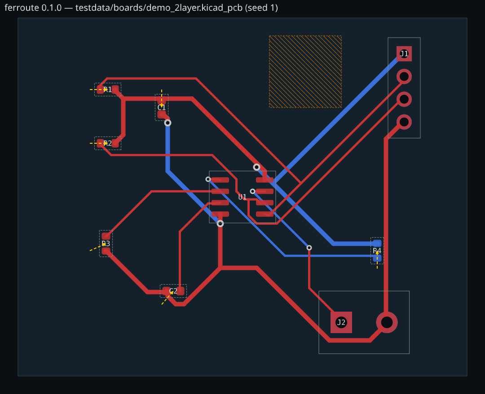

# ferroute

**Placement-aware, GPU/multi-core accelerated PCB autorouter for KiCad 10 & 11 — written in Rust, with an exact DRC oracle that gates every result.**

[](https://github.com/vanhanit/ferroute/actions/workflows/ci-release.yml)
[](LICENSE)
[](COMMERCIAL.md)



*`testdata/boards/demo_2layer.kicad_pcb` (KiCad 10) routed by `ferroute route --allow-move`:
100 % completion, 8 vias, 0 DRC errors in both ferroute's oracle and KiCad 10.0.8
`kicad-cli pcb drc`. Yellow arrows show unlocked passives that were nudged; the hatched
area is a keep-out.*

## Why another autorouter?

Existing KiCad autorouting stalls on dense boards: nets are committed greedily one at a
time, rip-up passes cycle without memory, and placement is treated as immutable even
when moving one resistor half a millimetre would open a channel. ferroute combines:

* **Negotiated congestion (PathFinder)** on a multi-layer octilinear lattice: all nets
  compete for resources with present + history costs instead of first-come-first-served.
* **Placement co-optimisation:** explicitly *unlocked* parts (default `R*`, `C*`, `L*`,
  `FB*`; your globs) may be translated within a bound — always onto an absolute placement
  grid (`--move-grid`, default 0.1 mm) — and rotated by 90° when that helps routing.
  **Locked footprints never move.**
* **Clean geometry:** tracks run on a pad-aligned 0°/45°/90° lattice, are straightened by
  a smoothing pass, and every connection enters its pad along an axis through the
  centre (side midpoint for rectangular pads) and ends exactly at the pad centre.
* **Correct by construction, verified anyway:** inter-net clearance follows from a
  *lattice separation theorem*; every fixed-obstacle decision uses exact integer
  geometry; and the independent DRC oracle refuses to emit anything it flags.
* **Deterministic:** `--seed` replays a run bit-for-bit — across thread counts,
  CPU/GPU accelerators and platforms (no host-libm in solver decisions).
* **Portable speed:** `rayon` on every CPU, optional `wgpu` GPU kernels
  (Vulkan/Metal/DX12) for clearance fields; accelerators can never change results.
* **KiCad-native:** lossless `.kicad_pcb` editing (KiCad 6–10 dialects, KiCad 10's
  net-by-name format), the KiCad IPC API in pure Rust (live KiCad 10 GUI, headless
  KiCad 11 `kicad-cli api-server`, KiCad 11 IPC plotting), never the deprecated SWIG bindings.

Read the design in [`docs/ARCHITECTURE_RFC.md`](docs/ARCHITECTURE_RFC.md).

## Quick start

```bash
# Build (Rust toolchain is pinned in rust-toolchain.toml)
cargo build --release -p ferroute-cli          # add --features gpu for wgpu acceleration

# Route a board, letting passives move up to 1.5 mm
./target/release/ferroute route board.kicad_pcb -o board.routed.kicad_pcb \
    --allow-move --max-move 1.5mm --seed 42 --report report.json --svg routed.svg

# Check any board with the exact DRC oracle
./target/release/ferroute drc board.routed.kicad_pcb --fail-on-violation
```

Or with nothing but Docker and make:

```bash
make dev-image && make build && make e2e && make kicad10-drc
```

### Live KiCad

```bash
# KiCad 10 GUI (enable Preferences → Plugins → "Enable KiCad API")
ferroute ipc probe                 # version + capability negotiation
ferroute ipc route --allow-move    # save → route → reload the open board

# KiCad 11 headless (nightlies)
kicad-cli api-server --socket /tmp/k/api.sock board.kicad_pcb &
ferroute ipc probe --socket ipc:///tmp/k/api.sock --json
ferroute ipc export-svg --socket ipc:///tmp/k/api.sock --out plots/
```

### Command overview

| Command | Purpose |
|---|---|
| `ferroute route IN -o OUT` | Nudge (opt-in) → route → LNS → DRC gate → write KiCad file (+ JSON report, SVG) |
| `ferroute drc BOARD` | Exact DRC: clearance/shorts, edge, holes, keep-outs, courtyards, sizes, connectivity |
| `ferroute render BOARD -o SVG` | Deterministic SVG with DRC markers and ratsnest |
| `ferroute gen --suite ci -o DIR` | Seeded synthetic benchmark boards (.kicad_pcb + .kicad_pro) |
| `ferroute bench --baseline bench/baseline.json` | Score boards (DRC, completion, wirelength, vias, displacement, runtime) and gate regressions |
| `ferroute ipc probe/route/export-svg` | KiCad IPC API integration |
| `ferroute info` | Compute backends (CPU threads, GPU adapter) |

Useful `route` flags: `--allow-move`, `--movable 'R*,C*,J5'`, `--exclude 'C1*'`,
`--max-move 2mm`, `--move-grid 0.1mm`, `--no-rotate`, `--pitch 0.4mm`, `--layers F.Cu,B.Cu`,
`--accel auto|cpu|gpu|none`, `--iterations 50`, `--lns-rounds 2`, `--seed N`.

## Benchmarks (v0.1 baseline)

| board | DRC | completion | wirelength (mm) | vias | moved | runtime (ms) |
|---|---|---|---|---|---|---|
| ci-s2-small (2 layers) | ✅ | 100 % | 163.8 | 5 | 9 | 44 |
| ci-s2-medium (2 layers) | ✅ | 100 % | 345.5 | 16 | 22 | 139 |
| ci-s4-medium (4 layers) | ✅ | 100 % | 414.1 | 11 | 30 | 204 |
| demo_2layer (KiCad 10 fixture, nudging) | ✅ | 100 % | 313.1 | 8 | 6 | 63 |
| demo_2layer (placement fixed) | ✅ | 100 % | 338.1 | 7 | 0 | 87 |
| legacy_v9_numeric (KiCad 9 fixture) | ✅ | 100 % | 18.2 | 0 | 0 | 3 |

CI re-runs this suite on every PR and fails on any DRC regression, completion drop, or
quality regression beyond tolerance (`crates/ferroute-engine/src/score.rs`). These v0.1
boards are modest; dense BGA and 4–8-layer suites are on the roadmap.

## Guarantees and their tests

| Guarantee | How it is enforced |
|---|---|
| No DRC violation introduced | exact oracle as final gate; proptest over hundreds of random dense boards; KiCad 10 `kicad-cli pcb drc` CI lane |
| Locked parts never move; nudges stay in bounds | `BoardEdit::check_invariants` (also re-checked by the KiCad writer); nudger proptests |
| Same seed ⇒ same output | 1/3/4-thread equality tests; frozen PRNG golden values; IEEE-only math in decisions |
| Accelerators never change results | legality tables identical with/without the field |
| Untouched KiCad content is preserved | lossless S-expression edits; byte-identity tests |

## Project status

v0.1 is a **vertical slice**: KiCad 10 files in/out, two- and multi-layer through-via
routing, nudging, IPC probe/live bridge, KiCad 11 headless/export client, CI lanes.
Not yet: differential pairs, length matching, BGA escape, blind/buried vias, copper-pour
awareness, gridless smoothing. See the roadmap in the RFC and the task board in
[`CLAUDE.md`](CLAUDE.md).

## Contributing

Conventional Commits, `make lint test` green, invariants respected — see
[`CONTRIBUTING.md`](CONTRIBUTING.md). Security issues: [`SECURITY.md`](SECURITY.md).

## Licence

ferroute is **dual-licensed**: [GNU AGPL-3.0-only](LICENSE) for open-source use
(including the network-use clause, §13), or a **commercial licence** for proprietary or
closed-source use — see [`COMMERCIAL.md`](COMMERCIAL.md) and [`NOTICE`](NOTICE).
Boards you route with ferroute are yours; the licence applies to the software.

KiCad is a trademark of the KiCad project; ferroute is an independent project.
